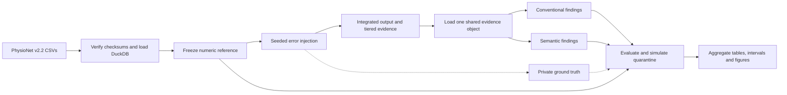

# When Valid Healthcare Data Produces Wrong Analytics: Benchmarking Semantic Data Quality

Lab results can pass schema checks while carrying the wrong unit or clinical code when systems exchange them. I built a benchmark in **Python, SQL, and DuckDB** using **11,740 laboratory observations from 100 patients** in MIMIC-IV Demo v2.2. Under controlled, simulated integration errors, semantic checks raised pooled observation recall from **35.24% to 74.60%** when both methods had the same trusted registry.

**Research question.** How effectively does semantic validation detect healthcare data integration errors and reduce their impact on downstream analytics compared with conventional data-quality checks?

- **Terminology helped.** The **39.36 percentage-point** recall gain pools 90 perturbed runs under the error-only scoring policy.
- **Evidence mattered.** Both methods identified **21,306 omitted observation exposures** and **150 removed mapping entries** once they had the upstream inventory. Output-only validation could not identify which observations disappeared.
- **Quarantine could make analytics worse.** Mean distortion is the absolute percentage difference from the clean reference mean, summarized here as the median across ten seeds. At a 5% unit-error target, semantic quarantine reduced glucose distortion from **19.85% to 2.34%**. Creatinine distortion rose from **216.07% to 220.11%** because quarantine removed downward errors while larger upward errors remained.

[Technical report](docs/technical-report.md) · [Creatinine audit](docs/results-audit.md) · [Evaluation protocol](docs/evaluation-protocol.md) · [Portfolio case study and interview guide](docs/portfolio.md)


## What I Built

- A [checksum-verified ETL pipeline](src/semantic_quality/ingestion.py) that loads the source tables into DuckDB for reproducible SQL analysis.
- [Conventional validation](src/semantic_quality/baseline_validation.py) for structure and reconciliation, plus [semantic validation](src/semantic_quality/semantic_validation.py) for analyte, specimen, and unit compatibility.
- An [experiment evaluator](src/semantic_quality/evaluation.py) that scores detection and measures downstream distortion, with a [paired patient-cluster bootstrap](src/semantic_quality/cluster_bootstrap.py) that resamples whole patients within fixed batches.

For a quick check, install [uv](https://docs.astral.sh/uv/) and run `uv run --locked python -m pytest -q` from the repository root. The tests use fabricated inputs and can run without downloading MIMIC. [Full reproduction workflow](#reproduce-locally)

## Why it matters

Unit, terminology, and mapping errors can enter a warehouse without breaking schema checks. They can shift cohort counts, change averages, or send investigators looking for clinical explanations for an ETL defect. The benchmark separates detection from analytical recovery and measures what each approach can establish with the available evidence. The same design applies to other data pipelines where identifiers and units carry meaning across systems.

## Dataset and design

The project uses three checksum-verified tables from **MIMIC-IV Clinical Database Demo v2.2**. The frozen reference contains **11,740 numeric observations from 100 patients** across glucose, creatinine, sodium, and potassium. Three nonnumeric potassium events are retained locally in a source audit. The original measurements are deidentified clinical observations. Unit and mapping errors, feed batches, and labels are simulated. [Dataset release](https://doi.org/10.13026/dp1f-ex47) · [Aggregate profile and eligibility](docs/dataset-profile.md) · [Reference fingerprint](configs/reference-lock.json)



| Evidence tier | Inputs available to both methods |
|---|---|
| **1 · Output-only** | Integrated lab results and their output metadata |
| **2 · Source-aware** | Tier 1 plus upstream observation IDs and batch mapping entries |
| **3 · Registry-aware** | Tier 2 plus a versioned source mapping and LOINC/UCUM registry |

Conventional checks cover structure, types, required values, duplicate IDs, broad numerical screening, upstream reconciliation, and registry membership where available. Semantic checks add analyte, specimen, quantity, and unit relationships. Both arms use the same inputs and reconciliation logic within each tier. Only the evaluator receives the simulation labels. [Rules and evidence fields](docs/phase-4.md)

## Results

Scenarios cover unit and value changes, incorrect mappings, and incomplete mappings. Each nonzero scenario used targets of **2.5%, 5%, and 15%** with **ten seeds per rate**. Three zero-rate controls had no findings. The target rate applies to eligible observations in A and mapping keys in B/C. The realized number of affected observations changes with batch size. [Scenario specification](docs/phase-3.md) · [Run-level realized rates](results/phase-5/runs.csv)

At Tier 3, error-only observation recall was **25.18%** for unit and value errors and **78.14%** for incorrect mappings under semantic validation. Conventional recall was **0%** in both. In the incorrect-mapping scenario, semantic validation found **143 of 180 mapping entries** under the error-only policy. Counting **37 review-only mapping entries** raised mapping recall to 100% in this simulation. Review findings represent cases for human investigation. Zero false positives were observed under the benchmark conditions. [Observation and mapping counts](results/figures/mapping-and-observation.png) · [Precision, recall, F1 and confusion tables](results/phase-5/detection_summary.csv)

### Why creatinine got worse

At the 5% target with seed 42, the clean creatinine mean was **1.542 mg/dL**. The integrated mean was **5.021 mg/dL**, and quarantine raised it to **5.085 mg/dL**. The 38 removed rows averaged **0.0197 mg/dL** after interpreting their incorrect labels. Stale-label and value-only rows still carried numbers on the `umol/L` scale with an `mg/dL` label. They stayed in the output, and removing the low values increased the average of the remaining rows. An independent SQL reconstruction reproduced the result in all ten seeds. [Creatinine reconstruction](docs/results-audit.md) · [Failure-case figure](results/figures/creatinine-quarantine.png)

| Relative mean distortion at the 5% target | Integrated | Conventional quarantine | Semantic quarantine |
|---|---:|---:|---:|
| Scenario A · Glucose | 19.85% | 19.85% | 2.34% |
| Scenario A · Creatinine | 216.07% | 216.07% | 220.11% |
| Scenario B · Potassium | 70.06% | 70.06% | 0.00% |

Values are the median distortion across ten seeds at Tier 3. Quarantine only removes records. It cannot repair values or recover observations absent from the integrated dataset. [All analytes and stages](results/phase-5/impact_summary.csv) · [Distortion figure](results/phase-5/figures/mean_distortion.png) · [Omission and coverage figure](results/phase-5/figures/omission_retention.png)

The conditional bootstrap resamples whole patients within fixed batches. At the 5% anchor, the recall gain was **25.3 points** in A (95% interval **20.4–28.6**) and **68.5 points** in B (**48.3–80.8**). Seed variation answers a different question: how results change when the error assignments change. [Uncertainty figure](results/figures/recall-uncertainty.png)

## Reproduce locally

Install [uv](https://docs.astral.sh/uv/). From the repository root:

```sh
uv sync --locked
uv run --locked python -m semantic_quality.ingestion --download
uv run --locked python -m semantic_quality.profiling
uv run --locked python -m semantic_quality.reference
uv run --locked python -m semantic_quality.evaluation
uv run --locked python scripts/audit_results.py
uv run --locked python scripts/portfolio_figures.py
uv run --locked python -m pytest -q
```

The downloader fetches only the three named v2.2 files and verifies them before loading. To use local copies, put the files in `data/raw/` and omit `--download`. The evaluator generates the scenario inputs, runs both validators and produces the aggregate tables and figures. A clean Apple Silicon replay took **164 seconds** for the benchmark step and used about **237 MiB** peak resident memory for that step. [Measured environment and staged commands](docs/reproducibility.md)

| Location | Purpose |
|---|---|
| [src/semantic_quality/](src/semantic_quality/) and [sql/](sql/) | Ingestion, reference snapshots, simulations, validation, evaluation |
| [configs/](configs/) | Pinned checksums, mappings, terminology registry, and protocol |
| [tests/](tests/) | Fabricated fixtures and regression tests |
| [scripts/](scripts/) | Independent results audit and portfolio figures |
| [results/](results/) | Aggregate tables and figures |

## Limitations and next steps

One hospital's 100-patient demo and its four selected analytes limit generalization. Feed batches and error rates are synthetic. Repeated measurements require patient-level resampling. Whole-blood versus serum/plasma can be uncertain from the source label, and no validation tier has an independent original value for checking plausible arithmetic errors. A natural extension is to test a second interface with verified specimen metadata and paired original measurements, then compare quarantine with a separately evaluated repair policy.

## Attribution and licensing

Contains information from MIMIC-IV Clinical Database Demo v2.2, Johnson, Bulgarelli, Pollard, Horng, Celi, and Mark (2023), PhysioNet, RRID:SCR_007345, made available under ODbL 1.0. The source data and patient-level derivatives stay in Git-ignored local storage. This repository provides the versioned sources and transformation code needed to regenerate the aggregates. [Dataset citation](https://doi.org/10.13026/dp1f-ex47) · [ODbL 1.0](https://opendatacommons.org/licenses/odbl/1-0/) · [Terminology and external-source notices](NOTICES.md) · [Official LOINC distribution notice](https://loinc.org/license#copyright-notice-and-license)

The project's original code is available under the [MIT License](LICENSE). The [third-party notices](NOTICES.md) document the separate terms for MIMIC-IV, applicable derivative data, LOINC, and UCUM.
