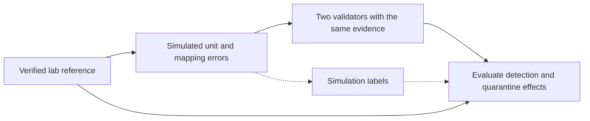
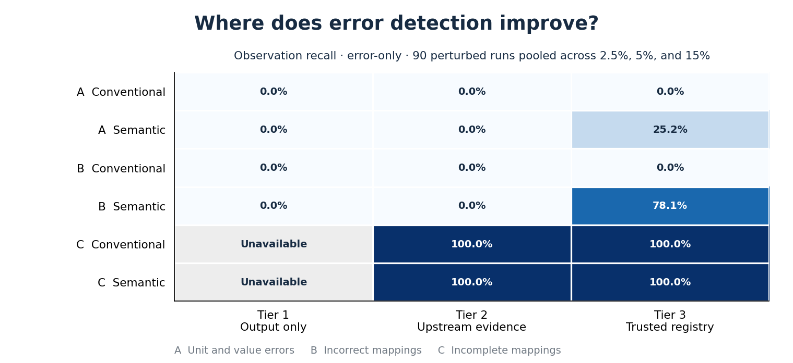

# Clinical Semantic Data Quality Benchmark

Lab data can have all required fields and valid codes but still describe the wrong test or unit. Codes identify the test, units determine how to interpret its value, and mappings connect incoming test identifiers to clinical codes.

This benchmark compares conventional data-quality checks with semantic checks that also examine what the codes and units mean. Across **90 runs with simulated errors**, conventional checks detected **35.24%** of injected observation errors, compared with **74.60%** for semantic checks. These are pooled recall figures with the same trusted registry available to both methods; scoring excludes review-only flags.

**Finding erroneous records was not enough to improve every analysis.** Removing flagged rows improved the glucose mean but made the creatinine mean worse in the unit-error experiment. These are controlled simulation results, not findings from a production clinical system.

## Core technologies

**Python · SQL · DuckDB**, with NumPy for numerical work, Matplotlib for figures and pytest for tests.

[Technical report](docs/technical-report.md) · [Creatinine audit](docs/results-audit.md) · [Evaluation protocol](docs/evaluation-protocol.md) · [Portfolio summary and technical discussion](docs/portfolio.md)

## What the benchmark does

The reference contains **11,740 numeric lab observations from 100 patients** in **MIMIC-IV Clinical Database Demo v2.2**, covering glucose, creatinine, sodium and potassium. Measurements are deidentified clinical observations; errors, batches and error labels are simulated. Three nonnumeric potassium events are retained locally in the source audit. [Dataset and eligibility](docs/dataset-profile.md) · [Reference fingerprint](configs/reference-lock.json)

The pipeline has three main parts:

- [Load and verify the data](src/semantic_quality/ingestion.py): check the official file checksums and load three source tables into DuckDB.
- Compare [conventional checks](src/semantic_quality/baseline_validation.py) for structure, reconciliation and registry membership with [semantic checks](src/semantic_quality/semantic_validation.py) for test identity, specimen, quantity and units. Inputs are identical within each evidence tier.
- [Evaluate detection and downstream effects](src/semantic_quality/evaluation.py): score the findings and measure how removing flagged rows changes summaries. Only the evaluator receives the simulation labels.



The [technical report](docs/technical-report.md#experimental-methodology) explains the full design; the [rule catalog](docs/phase-4.md) maps checks to their required evidence.

## Main results

The **39.36 percentage-point recall gain** uses the **Tier 3, error-only** policy. Counts are pooled across repeated runs of the same cohort, not distinct patients or an average of run-level recall.

Both methods receive the same evidence at each tier:

| Evidence tier | Inputs available to both methods |
|---|---|
| **1 · Output-only** | Integrated lab results and their output metadata |
| **2 · Source-aware** | Tier 1 plus upstream observation IDs and batch mapping entries |
| **3 · Registry-aware** | Tier 2 plus a versioned source mapping and LOINC/UCUM registry |

At Tier 3, both methods can check registry membership. Semantic rules also check the relationships between the test, specimen, quantity and unit.



| Scenario | Conventional observation recall | Semantic observation recall |
|---|---:|---:|
| A · Unit and value errors | 0% | 25.18% |
| B · Incorrect mappings | 0% | 78.14% |
| C · Incomplete mappings | 100% | 100% |

These are pooled Tier 3, error-only results. Each scenario used **2.5%, 5% and 15% targets**, with **ten seeds per target**. Targets apply to eligible observations in A and mapping keys in B/C, so they do not imply the same fraction of affected observations. Three additional zero-rate controls had no findings. No false positives were observed in the benchmark; this does not estimate production performance.

Two details help interpret the results:

- **Missing records require upstream evidence.** Across the 30 omission runs, both source-aware methods identified **21,306 omitted observation exposures** and **150 removed mapping entries**. These counts accumulate across repeated runs. Output-only observation recall is undefined for this scenario because the omitted IDs are unavailable.
- **Errors and reviews are separate.** In B, semantic checks classified **143 of 180 changed mapping entries** as errors and **37** as review-only. Including those reviews raised mapping recall to 100% in this simulation. Reviews identify cases for investigation, rather than confirmed violations.

Paired bootstrap intervals resample whole patients within fixed batches. At the 5% anchor, the recall gain was **25.3 points** in A (95% interval **20.4–28.6**) and **68.5 points** in B (**48.3–80.8**). Intervals hold error assignments fixed; seed variation changes those assignments. [Bootstrap implementation](src/semantic_quality/cluster_bootstrap.py) · [Uncertainty figure](results/figures/recall-uncertainty.png)

[Scenarios and target rates](docs/phase-3.md) · [Run-level realized rates](results/phase-5/runs.csv) · [Detection metrics](results/phase-5/detection_summary.csv) · [Mapping and observation counts](results/figures/mapping-and-observation.png)

## Why quarantine made creatinine worse

Quarantine removes flagged rows; it does not repair their values. In this experiment, removing correctly flagged creatinine errors left a more biased set of values behind.

At the **5% target, seed 42**, the clean creatinine mean was **1.542 mg/dL**. Simulated errors raised it to **5.021 mg/dL**, and semantic quarantine raised it further to **5.085 mg/dL**.

The **38 removed rows** had incorrect unit labels. Interpreting those labels made their mean **0.0197 mg/dL**, far below the integrated mean. Other errors left large numbers on the `umol/L` scale labelled as `mg/dL`. Those inflated values stayed in the output. Removing the low values therefore raised the remaining mean.

A separate SQL reconstruction reproduced the mechanism and matched the results for all ten seeds at this target. [Detailed reconstruction](docs/results-audit.md)

| Relative mean distortion at the 5% target | Integrated | Conventional quarantine | Semantic quarantine |
|---|---:|---:|---:|
| A · Glucose | 19.85% | 19.85% | 2.34% |
| A · Creatinine | 216.07% | 216.07% | 220.11% |
| B · Potassium | 70.06% | 70.06% | 0.00% |

Distortion is the absolute difference from the clean reference mean, divided by that reference mean and expressed as a percentage. Table entries are the median distortion across ten seeds at Tier 3; they are not the seed-42 values above. Quarantine cannot recover observations missing from the integrated dataset.

The practical finding is that detecting errors and improving an analysis need separate checks. [Creatinine figure](results/figures/creatinine-quarantine.png) · [All analytes and stages](results/phase-5/impact_summary.csv) · [Distortion figure](results/phase-5/figures/mean_distortion.png) · [Omission and coverage](results/phase-5/figures/omission_retention.png)

## Run and reproduce

For a quick check, install [uv](https://docs.astral.sh/uv/) and run this from the repository root:

```sh
uv run --locked python -m pytest -q
```

The tests use fabricated inputs and do not require a MIMIC download.

For full reproduction, use the pinned environment and run:

```sh
uv sync --locked
uv run --locked python -m semantic_quality.ingestion --download
uv run --locked python -m semantic_quality.profiling
uv run --locked python -m semantic_quality.reference
uv run --locked python -m semantic_quality.evaluation
uv run --locked python scripts/audit_results.py
uv run --locked python scripts/portfolio_figures.py
uv run --locked python -m pytest -q
```

The downloader fetches only the three named v2.2 files and verifies them before loading. To use local copies, place them in `data/raw/` and omit `--download`. The evaluator generates the scenario inputs, runs both validators and writes the aggregate tables and figures. A recorded Apple Silicon replay took **164 seconds** and about **237 MiB** peak resident memory for the benchmark step. [Environment and staged commands](docs/reproducibility.md)

Code is in [src/semantic_quality/](src/semantic_quality/) and [sql/](sql/), settings and locks in [configs/](configs/), fabricated fixtures in [tests/](tests/), audit and figure scripts in [scripts/](scripts/), and aggregate outputs in [results/](results/).

## Limitations and next steps

This is one hospital's 100-patient demo and four lab tests. Batches and error assignments are synthetic, so the findings do not establish performance on other hospitals or live interfaces. Repeated measurements require patient-level resampling, and mapping errors can affect multiple observations at once.

The source's broad blood labels leave some specimen distinctions uncertain. None of the validation tiers includes an independent original value for checking plausible conversion errors. A follow-up could use another interface with verified specimen metadata and paired original measurements. Repair would need its own evaluation before being compared with quarantine.

## Development approach

I directed the project, reviewed the Codex-generated work and made project decisions. **Codex wrote most of the implementation code.**

## Attribution and licensing

Contains information from MIMIC-IV Clinical Database Demo v2.2, Johnson, Bulgarelli, Pollard, Horng, Celi, and Mark (2023), PhysioNet, RRID:SCR_007345, made available under ODbL 1.0. The source data and patient-level derivatives stay in Git-ignored local storage. This repository provides the versioned sources and transformation code needed to regenerate the aggregates. [Dataset citation](https://doi.org/10.13026/dp1f-ex47) · [ODbL 1.0](https://opendatacommons.org/licenses/odbl/1-0/) · [Terminology and external-source notices](NOTICES.md) · [Official LOINC distribution notice](https://loinc.org/license)

The project's original code is available under the [MIT License](LICENSE). The [third-party notices](NOTICES.md) document the separate terms for MIMIC-IV, applicable derivative data, LOINC, and UCUM.
