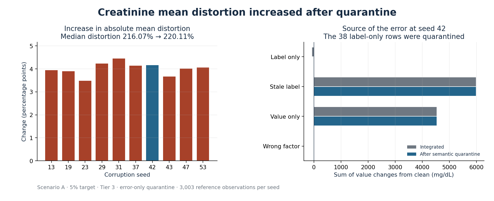

# Independent results audit

Recreate the checks from the repository root after the benchmark and reference are available.

```sh
uv run --locked python scripts/audit_results.py
```

The audit sums the Phase 5 **per-run** confusion counts independently of the summary SQL. At Tier 3 and under the error-only policy, conventional validation detected **21,306 / 60,452** injected observation exposures (35.24%), and semantic validation detected **45,099 / 60,452** (74.60%). Dividing the difference in the counts by the shared denominator gives **39.36 percentage points**. For A and B, conventional recall stayed at zero across tiers. Semantic Tier 3 recall rose to **3,230 / 12,830** (25.18%) in A and **20,563 / 26,316** (78.14%) in B. C's reconcilable recall was **21,306 / 21,306** in both arms. Output-only C observation recall is undefined because omitted IDs are unavailable to that tier. [Audit confusion counts by scenario, tier, unit, and policy](../results/audit/pooled_detection.csv)

For B, Tier 3 semantic validation identified 143 of 180 wrong **mapping entries** as errors and 37 as review-only. Review-inclusive observation recall was 32.04% in A and 100% in B. The 37 mapping reviews represent 5,753 affected observation exposures in B. These are two denominators. Zero false positives applies to this synthetic benchmark, including its clean-control conditions. Precision is undefined when an arm makes no positive predictions, as for conventional validation in A and B. Conditional intervals hold each anchor's batch and corruption assignments fixed. The separately tabulated seed variation changes the corruption assignments.

## What happened to creatinine

Independent DuckDB joins match each reported creatinine row to its frozen counterpart and apply the published factor directly. `mg/dL` values are left as reported. `umol/L` values are divided by **88.4**. The audit calls the frozen validator with only Tier 3 input files, then reads subtype labels separately. The independently computed reference, integrated, and quarantined means match the Phase 5 outputs for all ten seeds at the 5% target. [CDC conversion](https://wwwn.cdc.gov/Nchs/Data/Nhanes/Public/2011/DataFiles/BIOPRO_G.htm) · [Seed-level audit](../results/audit/creatinine_runs.csv)

| Seed 42, 5% target | Rows | Mean (mg/dL) | Median (mg/dL) |
|---|---:|---:|---:|
| Frozen reference | 3,003 | 1.5416 | 1.0 |
| Integrated | 3,003 | 5.0206 | 1.1 |
| Quarantined subset | 38 | 0.01968 | |
| After semantic quarantine | 2,965 | 5.0847 | 1.1 |

| Injected subtype | Rows | Quarantined | Sum of delivered minus original values (mg/dL) | Sum retained (mg/dL) |
|---|---:|---:|---:|---:|
| Label only | 38 | 38 | −65.35 | 0 |
| Value only | 38 | 0 | +4,527.32 | +4,527.32 |
| Stale label | 37 | 0 | +5,978.16 | +5,978.16 |
| Wrong factor | 37 | 0 | +7.21 | +7.21 |
| Correct conversion | 142 | 0 | 0 (floating-point roundoff) | 0 |

- **Corruption versus normalization.** The generator multiplies creatinine values by 88.4 for the intended alternate unit. Value-only and stale-label records keep the `mg/dL` label after their numbers have been scaled. The consumer trusts that label and therefore retains the inflated magnitudes. Label-only records keep their original number, but changing the reported unit to `umol/L` causes the consumer to divide that unchanged number by 88.4. Correct conversions round-trip to the clean values. Reconstructing the normalization independently found no factor or aggregation defect.
- **Selective quarantine.** All 38 flagged creatinine rows in this run were label-only. Their mean was far below the integrated mean. Removing a low group increases the remaining mean by `38 / 2,965 × (5.02056 − 0.01968)`, or **0.06409 mg/dL**. The much larger positive contributions from stale-label and value-only rows all remained. The absolute distortion increased at each of the ten seeds, yielding cross-seed medians of **216.07% before** and **220.11% after**.
- **Reference scale and sensitivity.** The denominator is the finite positive reference mean **1.54159 mg/dL**. At the seed-42 anchor the absolute changes from reference are **3.4790 mg/dL** before and **3.5431 mg/dL** after, so the phenomenon appears in the original unit as well as the relative percentage. The ten largest positive changes account for **40.7%** of the positive increase at the anchor. The median rose from 1.0 to 1.1 mg/dL and was unchanged by quarantine. The equal-patient-weighted sensitivity analysis also shows the increase, so testing frequency alone does not explain it. [Subtype arithmetic](../results/audit/creatinine_subtypes.csv) · [Patient-weighted results](../results/phase-5/impact_summary.csv)



The audit separates a **validator finding** from a **mitigation result**. The removed rows were correctly flagged. The unbalanced distribution of errors among the survivors moved the mean farther from the clean reference.
