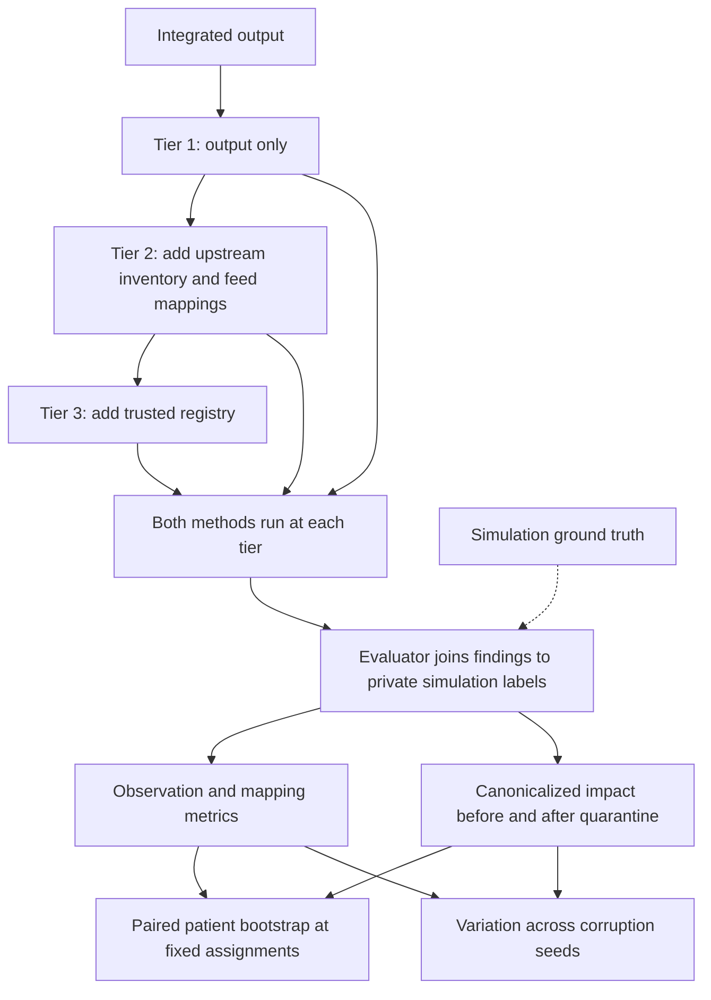

# When Valid Healthcare Data Produces Wrong Analytics

## Abstract

Can semantic validation detect healthcare integration defects and limit their effect on analytics? A reproducible benchmark used 11,740 lab observations from 100 patients in MIMIC-IV Clinical Database Demo v2.2, three controlled error scenarios, and three evidence tiers. Across 90 perturbed runs, Tier 3 error-only observation recall was 35.24% for conventional validation and 74.60% for semantic validation. Adding upstream evidence enabled both methods to identify all omitted observations in the tested mapping-deletion scenario. Selective quarantine reduced glucose mean distortion and increased creatinine mean distortion in the unit-error experiment. Detection and analytical recovery should be assessed separately.

## Background and motivation

Laboratory systems can deliver structurally valid measurements with incompatible units or incorrect clinical concept codes. LOINC codes can distinguish substance concentration from mass concentration and distinguish the specimen system, so test names alone cannot establish equivalence. Existing frameworks such as OHDSI's Data Quality Dashboard also perform concept and unit checks. This project studies the incremental effect of specific checks and evidence under controlled perturbations. [LOINC terminology guidance](https://loinc.org/kb/faq/content) · [OHDSI check catalog](https://ohdsi.github.io/DataQualityDashboard/articles/checkIndex.html)

## Dataset

The source is the open, deidentified MIMIC-IV Clinical Database Demo v2.2 from one hospital. SHA-256 checksums cover `labevents`, `d_labitems`, and `patients`. The reference includes finite values for glucose, creatinine, sodium, and potassium, with all 100 patients represented for each analyte. Three nonnumeric potassium rows are kept in a local exclusion audit. The 10 most frequently measured patients account for approximately 44–46% of observations for each analyte. The original results are clinical observations. The simulated changes described below are benchmark interventions. [Dataset](https://doi.org/10.13026/dp1f-ex47) · [Profiling report](dataset-profile.md)

## Experimental methodology

The reference is pinned by a file fingerprint and remains read-only during evaluation. A injects label-only, value-only, stale-label, and wrong-factor errors. It also produces correctly converted controls and valid alternate electrolyte units. B replaces mappings with another analyte's code or a wrong-specimen code. C removes mappings so selected records fail integration. B and C apply changes to batch–item keys and preserve upstream identifiers. Each patient belongs to one simulated feed batch. One protected mapping per analyte prevents global deletion in C.

Targets of 2.5%, 5%, and 15% at ten seeds yielded 90 perturbed runs, plus one zero-rate control per scenario. A targets eligible glucose and creatinine observations. B targets all batch mapping keys. C targets removable keys. This means a 5% target does not imply 5% of all observations were affected. For example, at that target B changed four keys per run and affected 373–949 observations. [Prespecified protocol](evaluation-protocol.md) · [Realized rates](../results/phase-5/runs.csv)

## Validation methods

The conventional arm checks schema, missingness, duplicates, numeric types, broad ranges and, where available, upstream reconciliation and registry membership. The semantic arm adds analyte identity, specimen class, quantity property, and unit compatibility. Both arms have identical inputs at each tier. Mapping targets are interpreted using the reviewed registry. A whole-blood substitution can warrant review because the source dictionary's `Blood` label does not resolve serum, plasma, or whole blood for a given record.

A *validation finding* is a check result with an ID, severity, and evidence. *Experimental ground truth* is an evaluator-only record of a deliberately injected change. Primary scoring counts errors only. Secondary scoring also counts reviews, preserving the distinction between a confirmed contract violation and an item for investigation. Neither method uses the reference values or simulation manifest. [Rule catalog and registry provenance](phase-4.md)

## Statistical evaluation

Observation-level confusion counts use unique observation IDs. Mapping-level counts use unique batch–item keys. Recall is the fraction of injected errors detected. Precision is the fraction of flagged entities with injected errors. No predicted positives means precision is undefined. The evaluator records omitted IDs as unavailable for output-only detection, and restores no records through quarantine.

For downstream summaries, the consumer groups values by **delivered LOINC analyte** and converts the reported unit to the canonical unit. It calculates mean, median, patient-weighted mean, observation retention, and patient coverage. The quarantine arm removes physical rows carrying error findings or linked to an error-flagged mapping. Review findings stay in the analytical dataset. Source-analyte attribution tracks omitted and quarantined records even if an incorrect code moves an observation into another downstream group.

Paired 95% percentile intervals use 399 draws of whole patients with replacement within fixed simulated batches, and the same draw for both methods. These intervals describe sensitivity to patient composition for the chosen assignments. Seed distributions describe variation when corruption assignments change. Mapping scores use seed distributions because many affected observations can share one mapping key. [Intervals and seed summaries](phase-5.md#uncertainty-and-interpretation)

## Results

| Tier 3, pooled over 90 nonzero runs | Conventional error-only recall | Semantic error-only recall | Semantic review-inclusive recall |
|---|---:|---:|---:|
| A · Unit and value errors | 0% | 25.18% | 32.04% |
| B · Incorrect mappings | 0% | 78.14% | 100% |
| C · Incomplete mappings | 100% | 100% | 100% |
| All three | 35.24% | 74.60% | 85.58% |

The primary pooled gain was 39.36 percentage points. B had 180 changed mapping entries, of which 143 generated semantic errors and 37 generated review-only findings. C's 150 removed entries affected 21,306 observation exposures. Both source-aware methods identified them all. Zero false positives were observed in the tested conditions. Under the 5% anchor assignments, the conditional observation recall gains were 25.3 points in A (95% interval 20.4–28.6) and 68.5 in B (48.3–80.8). [Confusion counts and metrics](../results/phase-5/detection_summary.csv) · [Mapping and observation figure](../results/figures/mapping-and-observation.png) · [Uncertainty figure](../results/figures/recall-uncertainty.png)

## Error analysis and discussion

Unit–quantity checks caught all label-only errors. A wrong factor can produce a compatible code, plausible unit, and plausible value. Neither arm detected any of the 3,170 wrong-factor errors. Direct verification of a conversion would require an independent original value. The omission scenario illustrates why the upstream inventory matters: a downstream row checker cannot name a row that never arrived, while an anti-join can identify its upstream ID. That still leaves a missing value for downstream summaries.

At a 5% target, the median relative glucose mean distortion across ten seeds fell from 19.85% to 2.34% after semantic quarantine. Creatinine distortion rose from 216.07% to 220.11%. An independent SQL reconstruction showed that the detector removed only the low label-only errors. At seed 42, the 38 removed rows averaged 0.01968 mg/dL and the integrated group averaged 5.02056 mg/dL. Removing them raised the mean to 5.08465 mg/dL. Value-only and stale-label errors retained large numbers reported as mg/dL, which inflated the remaining mean. The clean mean was 1.54159 mg/dL. The increase was visible in original units and in the patient-weighted sensitivity analysis. In C, quarantine removed no additional records after integration had already omitted them. [Independent creatinine audit](results-audit.md) · [All analytes and stages](../results/phase-5/impact_summary.csv)

## Limitations

The cohort comes from one site. Four analytes, synthetic batches and errors, and a small curated terminology subset limit external validity. Repeated observations and batch-wide mapping errors reduce effective independence. Neither the synthetic error rates nor the observed specificity estimate real interface performance. The source lacks independently verified per-observation specimen and paired pre-conversion values. A production policy would also need to consider how quarantine changes cohorts and whether repair is verifiable.

## Conclusion

Terminology rules found discrepancies among records that passed shared structural checks. Upstream evidence explained the gains in omission detection for both arms. Selective quarantine changed the error mix and made one measured mean worse. A data-quality system should evaluate downstream retention and distortion alongside detection, especially when quarantine is the available mitigation.

## References

- Johnson, A., Bulgarelli, L., Pollard, T., Horng, S., Celi, L. A., and Mark, R. (2023). *MIMIC-IV Clinical Database Demo v2.2*. PhysioNet. [Dataset and citation](https://doi.org/10.13026/dp1f-ex47)
- Regenstrief Institute. *Logical Observation Identifiers Names and Codes* and the *Unified Code for Units of Measure*. [LOINC](https://loinc.org/) · [UCUM](https://ucum.org/ucum)
- CDC National Center for Health Statistics. *NHANES 2011–2012 Standard Biochemistry Profile*. [Conversion factors](https://wwwn.cdc.gov/Nchs/Data/Nhanes/Public/2011/DataFiles/BIOPRO_G.htm)
- MIT Laboratory for Computational Physiology. *MIMIC Code*. [Laboratory crosswalk](https://github.com/MIT-LCP/mimic-code/blob/main/mimic-iv/mapping/d_labitems_to_loinc.csv) · [Chemistry plausibility screens](https://github.com/MIT-LCP/mimic-code/blob/main/mimic-iv/concepts/measurement/chemistry.sql)
- OHDSI. *DataQualityDashboard*. [Quality-check catalog](https://ohdsi.github.io/DataQualityDashboard/articles/checkIndex.html)
